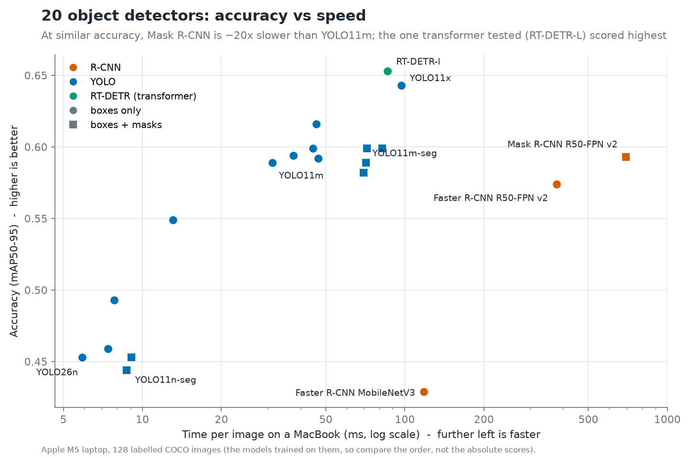
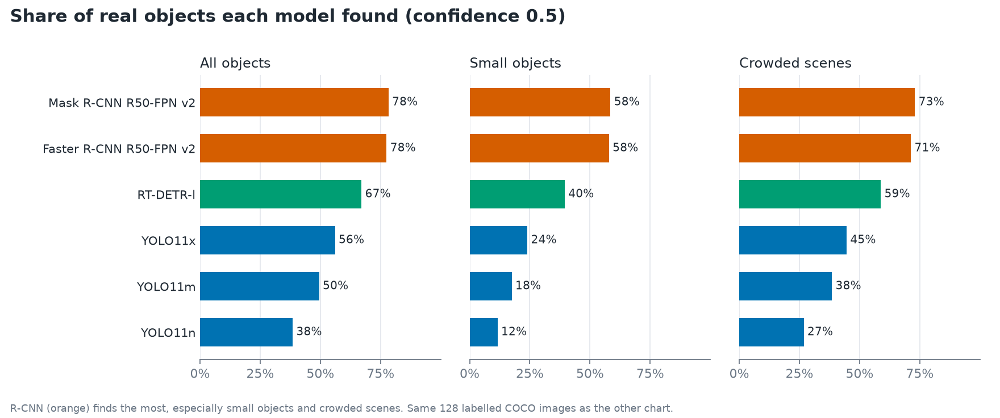

# Object Detection Showdown: R-CNN vs YOLO vs transformers (and video memory with an RNN)

An honest, reproducible comparison of **20 object detectors and segmenters** on one laptop, plus a small
**video -> CNN -> GRU** system that tries to understand what is happening over time.

> Start with the **[Learning Guide](docs/LEARNING_GUIDE.md)** if you are new to this. It explains every idea in plain English.

## The result in five lines
1. **"R-CNN is more accurate, YOLO is faster" is only half true.** On average accuracy Mask R-CNN (0.593 mAP50-95) is level with YOLO11m (0.589), but about **22x slower** (about 696 ms vs 31 ms).
2. **R-CNN's real edge is finding things:** it found 78% of all objects (YOLO11m: 50%) and 58% of the small ones (YOLO11m: about 18%).
3. **In crowded scenes** (about 40 objects) Mask R-CNN made 47 / 40 / 32 masks; the best YOLO segmentation models made 3 to 21.
4. **Best average accuracy** went to a transformer, RT-DETR-L (0.653), not to either classic family.
5. **A GRU that remembers video state did not beat simple baselines** on a 20-second clip. A documented negative result.




## Read this before quoting any number
- The test images are **128 COCO *training* images**, which the models trained on, so scores are inflated. **Trust the order, not the absolute values.**
- Everything was measured on **one Apple M5 MacBook**; speeds will differ on your hardware.
- **Mask quality** was judged by eye on a few images; only mask *counts* were compared with the real object counts.
- **RF-DETR, D-FINE, LW-DETR and YOLO-ULM were not run.** They appear in the README tables as published numbers from official pages, clearly marked.
- The video experiment is **one clip**, with labels written by hand. It is a demonstration, not a benchmark.

## What is in this repo
```
docs/LEARNING_GUIDE.md      beginner-friendly explanation of everything (start here)
docs/LINKEDIN_POST.md       post draft, images to attach, how to post, answers to likely challenges
detector_test/
  README.md                 full tables, method, caveats, what is measured vs published vs unverified
  compare_models.py         runs every available model on the same images, draws input + all outputs side by side
  eval_coco128.py           accuracy vs ground-truth labels (mAP, precision, recall, by size, crowded scenes)
  speed_bench.py            clean timings, one model loaded at a time
  make_tables.py / make_charts.py   build the tables and charts from saved results
  results/                  charts, side-by-side pictures (sidebyside_*.jpg), JSON results
video_state/
  README.md                 the video pipeline, shapes, honest results
  video_state.py            video -> frames -> YOLO + tracker + CNN features -> GRU states
  video_state_supervised.py supervised GRU vs baselines (blocked cross-validation)
  labels.csv                hand-written labels for the demo clip
  results/                  analysis.json, supervised.json, arrays.npz (the clip itself is not included)
get_assets.py               downloads weights (about 1 GB) and the test images
requirements.txt
```

## Quick start
```bash
python -m venv .venv && source .venv/bin/activate
pip install -r requirements.txt
python get_assets.py                       # about 1.1 GB: model weights + coco128 + sample images
cd detector_test
python compare_models.py                   # side-by-side pictures in results/
python eval_coco128.py                     # accuracy vs ground truth (a few minutes)
python speed_bench.py && python make_tables.py && python make_charts.py
cd ../video_state
python video_state.py your_clip.mp4        # then: python video_state_supervised.py (needs your own labels.csv)
```
Tested with Python 3.12, torch 2.15.0, torchvision 0.29.2, ultralytics 8.4.212, lap 0.5.14 on macOS (Apple M5, MPS). On other machines the code uses MPS if available, else CPU (`cuda` is not wired in; change `dev` in `compare_models.py`).

## Licences and credits
- Code in this repo: MIT (see `LICENSE`).
- Model weights and libraries keep their own licences: **Ultralytics YOLO is AGPL-3.0** (or commercial), torchvision is BSD-3-Clause. Check them before commercial use.
- Test images: **COCO** (annotations CC BY 4.0; individual images carry their own Flickr licences) via the Ultralytics `coco128` subset. `bus.jpg` and `zidane.jpg` are Ultralytics sample images. The side-by-side pictures in `detector_test/results/` contain COCO images; credit COCO if you reuse them.
- Published numbers come from the Ultralytics docs, torchvision docs, the D-FINE repo, Roboflow's RF-DETR docs, and the papers cited in `detector_test/README.md`.
